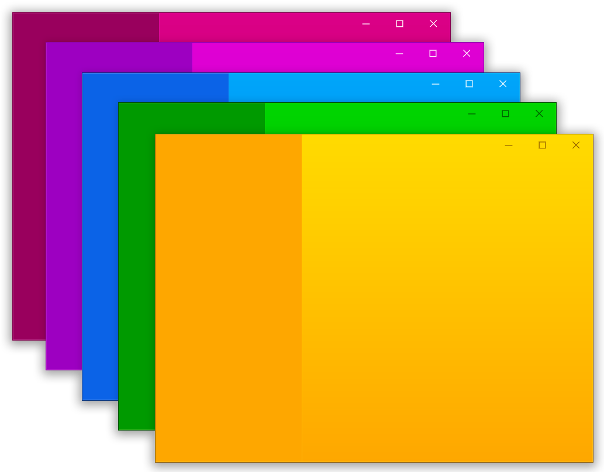

[](https://pub.dev/packages/window_controls)
[](https://pub.dev/packages/window_controls)
[](https://pub.dev/packages/window_controls)

[](https://github.com/Ali-Fadaei/Window-Controls-Flpk/stargazers)
[](https://github.com/Ali-Fadaei/Window-Controls-Flpk/actions/workflows/build_test.yaml)
[](https://github.com/Ali-Fadaei/Window-Controls-Flpk/blob/main/LICENSE)

# window_controls

A [Flutter package](https://pub.dev/packages/window_controls) that makes it easy to customize and work with your Flutter desktop app window on **Windows**, **macOS** and **Linux**.



**Features**:

- Custom window frame - remove standard Windows/macOS/Linux titlebar and buttons
- Hide window on startup
- Show/hide window
- Move window using Flutter widget
- Minimize/Maximize/Restore/Close window
- Set window size, minimum size and maximum size
- Set window position
- Set window alignment on screen (center/topLeft/topRight/bottomLeft/bottomRight)
- Set window title

# Getting Started

Add the package to your project's `pubspec.yaml` file manually or using the command below:

```shell
flutter pub add window_controls
```

The `pubspec.yaml` file should look like this:

```diff
// pubspec.yaml

  ...

  dependencies:
    flutter:
      sdk: flutter
+ window_controls: ^0.1.0

  dev_dependencies:

  ...
```

# For Windows apps

Inside your application folder, go to `windows\runner\main.cpp` and change the code look like this:

```diff
// windows/runner/main.cpp

  ...

  #include "flutter_window.h"
  #include "utils.h"

+ #include <window_controls_windows/window_controls_plugin.h>
+ auto wctl = window_controls_configure(WCTL_CUSTOM_FRAME | WCTL_HIDE_ON_STARTUP);

  int APIENTRY wWinMain(_In_ HINSTANCE instance, _In_opt_ HINSTANCE prev,

  ...
```

# For macOS apps

Inside your application folder, go to `macos\runner\MainFlutterWindow.swift` and change the code look like this:

```diff
// macos/runner/MainFlutterWindow.swift

  import Cocoa
  import FlutterMacOS
+ import window_controls_macos

- class MainFlutterWindow: NSWindow {
+ class MainFlutterWindow: WindowControls {
+     override func window_controls_configure() -> UInt {
+     return WCTL_CUSTOM_FRAME | WCTL_HIDE_ON_STARTUP
+   }
      override func awakeFromNib() {

      ...

    }
  }
```

#

If you don't want to use a custom frame and prefer the standard window titlebar and buttons, you can remove the `WCTL_CUSTOM_FRAME` flag from the code above.

If you don't want to hide the window on startup, you can remove the `WCTL_HIDE_ON_STARTUP` flag from the code above.

# For Linux apps

Inside your application folder, go to `linux\my_application.cc` and change the code look like this:

```diff
// linux/my_application.cc

  ...
  #include "flutter/generated_plugin_registrant.h"
+ #include <window_controls_linux/window_controls_plugin.h>

  struct _MyApplication {

  ...

  }

+  auto wctl = window_controls_from(window);
+  wctl->setCustomFrame(true);
-  gtk_window_set_default_size(window, 1280, 720);
   gtk_widget_show(GTK_WIDGET(window));

   g_autoptr(FlDartProject) project = fl_dart_project_new();

  ...

  }

```

# Flutter app integration

Now go to `lib\main.dart` and change the code look like this:

```diff
// lib/main.dart

  import 'package:flutter/material.dart';
+ import 'package:window_controls/window_controls.dart';

 void main() {
   runApp(MyApp());

+   doWhenWindowReady(() {
+     const initialSize = Size(600, 450);
+     appWindow.minSize = initialSize;
+     appWindow.size = initialSize;
+     appWindow.alignment = Alignment.center;
+     appWindow.show();
+   });
 }
```

This will set an initial size and a minimum size for your application window, center it on the screen and show it on the screen.

You can find examples in the [example](./window_controls/example) folder.

Here is an example that displays this window:

<details>
<summary>Click to expand</summary>

```dart
import 'package:flutter/material.dart';
import 'package:window_controls/window_controls.dart';

void main() {
  runApp(const MyApp());
  doWhenWindowReady(() {
    final win = appWindow;
    const initialSize = Size(600, 450);
    win.minSize = initialSize;
    win.size = initialSize;
    win.alignment = Alignment.center;
    win.title = "Custom window with Flutter";
    win.show();
  });
}

const borderColor = Color(0xFF805306);

class MyApp extends StatelessWidget {
  const MyApp({Key? key}) : super(key: key);

  @override
  Widget build(BuildContext context) {
    return MaterialApp(
      debugShowCheckedModeBanner: false,
      home: Scaffold(
        body: WindowBorder(
          color: borderColor,
          width: 1,
          child: Row(
            children: const [LeftSide(), RightSide()],
          ),
        ),
      ),
    );
  }
}

const sidebarColor = Color(0xFFF6A00C);

class LeftSide extends StatelessWidget {
  const LeftSide({Key? key}) : super(key: key);
  @override
  Widget build(BuildContext context) {
    return SizedBox(
        width: 200,
        child: Container(
            color: sidebarColor,
            child: Column(
              children: [
                WindowTitleBarBox(child: MoveWindow()),
                Expanded(child: Container())
              ],
            )));
  }
}

const backgroundStartColor = Color(0xFFFFD500);
const backgroundEndColor = Color(0xFFF6A00C);

class RightSide extends StatelessWidget {
  const RightSide({Key? key}) : super(key: key);
  @override
  Widget build(BuildContext context) {
    return Expanded(
      child: Container(
        decoration: const BoxDecoration(
          gradient: LinearGradient(
              begin: Alignment.topCenter,
              end: Alignment.bottomCenter,
              colors: [backgroundStartColor, backgroundEndColor],
              stops: [0.0, 1.0]),
        ),
        child: Column(children: [
          WindowTitleBarBox(
            child: Row(
              children: [Expanded(child: MoveWindow()), const WindowButtons()],
            ),
          )
        ]),
      ),
    );
  }
}

final buttonColors = WindowButtonColors(
    iconNormal: const Color(0xFF805306),
    mouseOver: const Color(0xFFF6A00C),
    mouseDown: const Color(0xFF805306),
    iconMouseOver: const Color(0xFF805306),
    iconMouseDown: const Color(0xFFFFD500));

final closeButtonColors = WindowButtonColors(
    mouseOver: const Color(0xFFD32F2F),
    mouseDown: const Color(0xFFB71C1C),
    iconNormal: const Color(0xFF805306),
    iconMouseOver: Colors.white);

class WindowButtons extends StatelessWidget {
  const WindowButtons({Key? key}) : super(key: key);
  @override
  Widget build(BuildContext context) {
    return Row(
      children: [
        MinimizeWindowButton(colors: buttonColors),
        MaximizeWindowButton(colors: buttonColors),
        CloseWindowButton(colors: closeButtonColors),
      ],
    );
  }
}
```

</details>

#

# Migrating from bitsdojo_window

`window_controls` keeps the same Dart API (`appWindow`, `doWhenWindowReady`, `WindowBorder`, `MoveWindow`, the window buttons and so on). To switch:

1. In `pubspec.yaml`, replace `bitsdojo_window` with `window_controls: ^0.1.0`.
2. Replace `package:bitsdojo_window/bitsdojo_window.dart` with `package:window_controls/window_controls.dart`.
3. In the runner code shown above, rename:
   - `bitsdojo_window_windows/bitsdojo_window_plugin.h` → `window_controls_windows/window_controls_plugin.h` (same for `_linux`)
   - `bitsdojo_window_configure` → `window_controls_configure`, `bitsdojo_window_from` → `window_controls_from`
   - `BDW_CUSTOM_FRAME`, `BDW_HIDE_ON_STARTUP` → `WCTL_CUSTOM_FRAME`, `WCTL_HIDE_ON_STARTUP`
   - macOS: `import bitsdojo_window_macos` → `import window_controls_macos`, and the `BitsdojoWindow` superclass → `WindowControls`

# Credits

`window_controls` started as a fork of [bitsdojo_window](https://github.com/bitsdojo/bitsdojo_window) by Bogdan Hobeanu, released under the MIT license. Thanks to him and its contributors for the original work.

# License

MIT. See [LICENSE](LICENSE).
